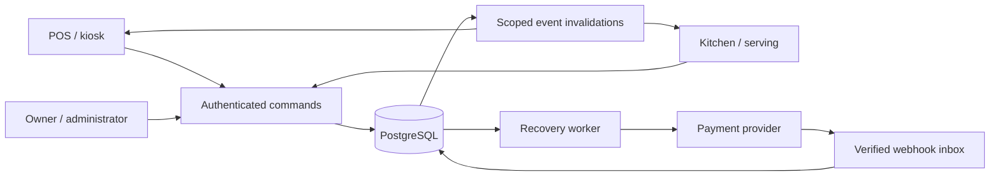

# Architecture and implementation decisions

## Modular monolith

React clients call a Fastify API over same-origin HTTPS. PostgreSQL transactions contain state updates, journal entries, audit records and outbox invalidations. A separate worker recovers provider outcomes. There are no cross-service distributed transactions.

## Identity and scope

An organization contains venues, each with independent currency/timezone/token sequence. Outlets are accounting businesses and have data-driven cuisine labels. Stations belong to one outlet. The initial implementation models cuisine classification as an outlet label, not a separate reusable taxonomy table; separating that taxonomy later does not change accounting ownership.

Each user has explicit role assignments with venue/outlet/station scope. Server authorization verifies actual persisted relationships. Scoped order views strip other outlets and financial data from kitchen accounts. Customer tracking uses a random bearer secret exchanged for an HttpOnly cookie, never a public token as authentication. Session and tracking secrets are hashed; idempotency response envelopes containing recovery secrets are encrypted at rest.

Application checks provide row authorization. PostgreSQL RLS is not enabled in this version; this is an explicit defense-in-depth deployment gap, not a claim of database-enforced tenant isolation. Deploy a restricted application role separate from the migration role. Existing database constraints and foreign keys validate core station/outlet relationships.

## Quote and payment boundary

Prices, tax, discounts, modifiers and station IDs are snapshotted into per-unit quote data. Money is integer minor units. Largest-remainder allocation preserves order discount totals. Inclusive and exclusive tax use BigInt intermediate arithmetic. Checkout verifies menu version, item versions, station validity and active holds. Venue locks serialize hold creation with checkout acceptance.

A pending checkout has a ten-minute acceptance lease. Existing accepted leases survive ordinary holds. Late captures that cannot be fulfilled materialize refundable units in PAYMENT_REVIEW, outside kitchen queues; manager release or cancellation/refund resolves them. `dispatched_at` is the materialization marker in this implementation; status controls release to staff. Payment review units cannot start cooking.

One payment intent has multiple observed provider attempts. A unique capture reference prevents duplicate external records. Different capture references for the same intent are recorded as excess captures, produce a separate refund liability, and raise an exception; they never create more kitchen work. See the exception runbook for finance handling of an excess capture.

## Fulfillment

An order has one suborder per outlet, station tickets, immutable line snapshots and unit-level work. Acknowledgement, preparation, completion, serving-ready and handover are separate transitions. Versions protect concurrent commands. Cancellation holds block transitions. Unstarted units may be reassigned within the outlet. Rework adds a no-charge linked work unit and preserves history.

The active queue endpoint includes every outstanding order rather than hiding work beyond the recent-order list. The recent order screen uses a 100-record window; the API supports older timestamps. At larger scale, replace active queue snapshots with station-level keyset pages and a dedicated projection. This is required before claiming the full sustained-load target.

## Finance

Capture credits outlet payables. Versioned commission policies debit outlet payables and credit operator commission. Approval reserves a refund liability and reverses its allocated commission; confirmed refund settles that liability. A failed/unknown provider call retains the obligation and reservation. Refund capacity is locked per capture; cashier daily limits are serialized per actor. Reporting separates sales dates, refund dates and balance snapshots.

Balanced journal entries are checked by a deferred PostgreSQL trigger. Journal and audit updates/deletes are rejected by triggers. Corrections require new entries. Payout approvals reserve a payable; only bank evidence marks a payout paid. A frozen batch has supporting journal-line references. Automated bank payout initiation is intentionally excluded by the source specification.

## Delivery and durability

SSE carries only scoped invalidations, not raw mixed-owner order payloads. Clients re-fetch authorized snapshots, reconnect and poll on failure. Outbox IDs permit replay. Private tracking currently polls every two seconds. Redis is unnecessary for initial operation; introduce a broker when measured database/fan-out load requires it. The outbox is retained indefinitely until a retention/replay policy is approved; no silent cleanup destroys replay history.

Media upload validates file type/size, decodes, strips metadata, resizes to 900x600 and writes WebP. Menu media is public by design; internal incident evidence upload is not implemented. Local storage must be persistent/shared or replaced with an object-storage adapter before multi-instance deployment.

## Technology references

Implementation API usage was checked against the primary references:

- https://fastify.dev/docs/latest/Reference/Validation-and-Serialization/
- https://vite.dev/guide/
- https://www.postgresql.org/docs/current/transaction-iso.html
- https://github.com/razorpay/markdown-docs/blob/master/api/orders/create.md
- https://github.com/razorpay/markdown-docs/blob/master/api/refunds/normal-refunds-idempotent.md

Dependencies are locked in package-lock.json. Glob/minimatch overrides select patched releases; test them when updating Fastify static/Swagger packages.
